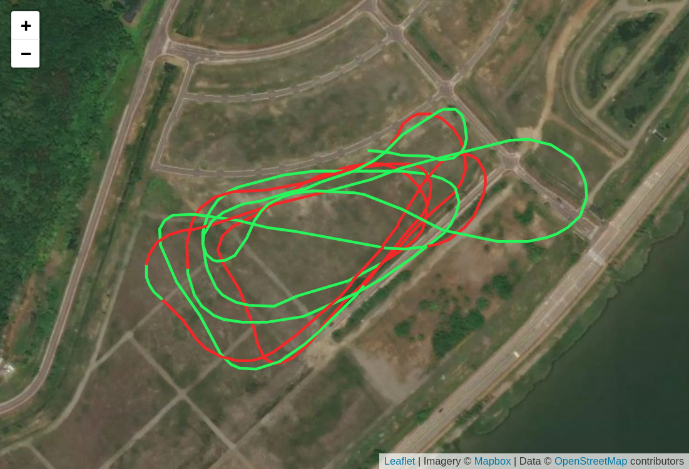
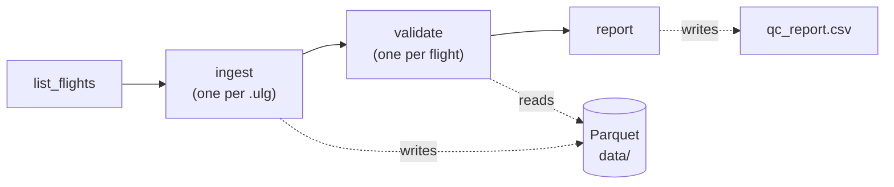
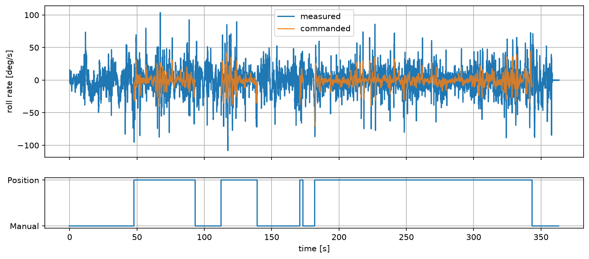
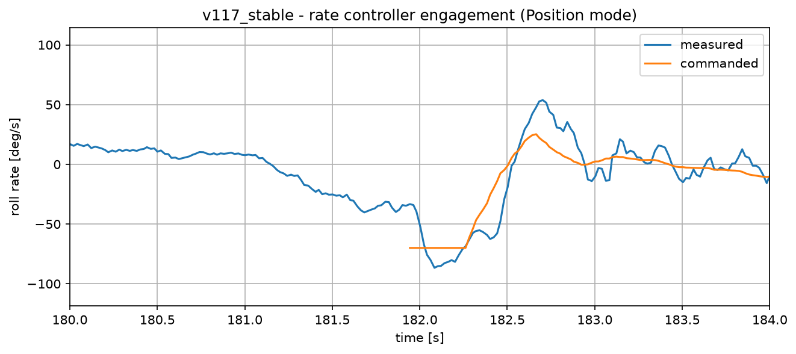
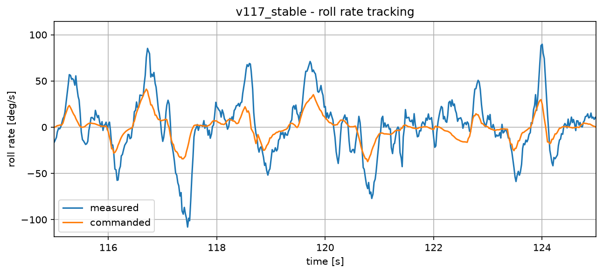

# Flight-Test Data Pipeline

**PX4 flight logs → validated, partitioned Parquet, orchestrated with Apache Airflow.**

A small post-flight data processing pipeline modeled on how flight-test data is handled: raw onboard recordings are decoded, checked for integrity, stored in a columnar format and summarized in a quality report, automatically and reproducibly for every flight.

It uses public flight logs from fixed-wing PX4 aircraft and was built as a learning project to get hands-on with Airflow, Parquet and real multi-rate sensor data.


*Flight track from PX4 Flight Review (imagery © Mapbox, map data © OpenStreetMap contributors).*

---

## Pipeline



| Task | What it does |
|---|---|
| `list_flights` | Finds all `.ulg` files in `raw/` |
| `ingest` | Decodes one log with `pyulog`, normalizes timestamps, writes one Parquet file per topic. **Dynamically mapped:** one task instance per flight |
| `validate` | Reads the written Parquet back and computes QC metrics per topic |
| `report` | Collects the results of all flights into `qc_report.csv` |

Tasks pass **file paths** via XCom, never data. The data itself lives in Parquet, so tasks stay independent and could run on separate machines with shared storage.


---

## Data

Two public logs from [PX4 Flight Review](https://logs.px4.io/browse) (licensed CC-BY PX4), both from a *Generic Standard Plane* airframe:

| `flight_id` | Firmware | Duration | Flight Review | Why it's included |
|---|---|---|---|---|
| `v117_stable` | v1.17.0 (stable) | 6:04 | [log](https://logs.px4.io/plot_app?log=c2885c52-4fd4-4473-9dfc-393de5c021be) | Clean baseline |
| `v0_unstable` | dev branch (`feature/kjs.0902`) | 2:47 | [log](https://logs.px4.io/plot_app?log=f086e2ea-74d9-46bf-a2ec-7f46c78dcc73) | Realistic "messy" case: one logger dropout, max tilt of 178.8° |

To reproduce: open each link, click **Download** and save the `.ulg` file into `raw/` as `<flight_id>.ulg`.

Topics extracted: `vehicle_attitude`, `vehicle_angular_velocity`, `vehicle_rates_setpoint`, `actuator_servos`, `airspeed_validated`, `vehicle_status`.

---

## Quickstart

Requires Linux and Python 3.10+ (developed on 3.14).

```bash
python -m venv .venv && source .venv/bin/activate

# Airflow must be installed with the constraints file matching your Python version
AIRFLOW_VERSION=3.3.2
PYTHON_VERSION="$(python -c 'import sys; print(f"{sys.version_info.major}.{sys.version_info.minor}")')"
pip install "apache-airflow==${AIRFLOW_VERSION}" \
  --constraint "https://raw.githubusercontent.com/apache/airflow/constraints-${AIRFLOW_VERSION}/constraints-${PYTHON_VERSION}.txt"

pip install -e ".[analysis,dev]"
```

**Run with Airflow:**
```bash
./start_airflow.sh          # UI on localhost:8080, login printed / in .airflow/
```
Then trigger the `flight_pipeline` DAG in the UI.

**Run without Airflow** (same functions, called in sequence):
```bash
python run_pipeline.py
```

**Tests:**
```bash
pytest -v
```

---

## Repository layout

```
├── dags/flight_pipeline.py   # Airflow DAG: wiring only, no logic
├── src/ftpipe/
│   ├── decode.py             # .ulg → DataFrames (int64 timestamps)
│   ├── store.py              # DataFrame → partitioned Parquet
│   ├── validate.py           # QC metrics per topic
│   └── align.py              # causal alignment of multi-rate signals
├── tests/                    # pytest, synthetic data with known answers
├── notebooks/analysis.ipynb  # exploration and plots
├── img/                      # figures used in this README
├── run_pipeline.py           # pipeline without Airflow
└── start_airflow.sh
```

All processing logic lives in the `ftpipe` package and is tested independently of Airflow. The DAG file only connects the functions.

---

## Storage layout

Hive-style partitioning, **topic first**, so each topic behaves like one table with a consistent schema across all flights:

```
data/
├── topic=vehicle_attitude/
│   ├── flight_id=<flight A>/data.parquet
│   └── flight_id=<flight B>/data.parquet
└── topic=vehicle_angular_velocity/
    └── ...
```

Query one topic across all flights, reading only the columns needed:

```python
import duckdb
duckdb.sql("""
  SELECT flight_id, count(*) AS samples
  FROM read_parquet('data/topic=vehicle_attitude/*/*.parquet', hive_partitioning=true)
  GROUP BY flight_id
""").show()
```

---

## Data quality checks

Computed per topic and flight in `validate.py`:

| Metric | Purpose |
|---|---|
| `rate_hz_median` | Actual logging rate (median interval, robust to gaps) |
| `dt_p99_ms` | Timing jitter the median hides |
| `n_gaps_3x` | Intervals longer than 3× the typical one |
| `n_nan` | Missing values |
| `duration_s` | Cross-check against the log's reported duration |

The QC functions are tested with synthetic signals where the correct answer is known by construction: a clean 20 Hz signal must produce no findings, and an injected gap or NaN must be found exactly once.

---

## Findings

Working with real logs surfaced several issues that a naive pipeline would get wrong:

1. **Logging rates differ by 10× between firmware builds.** `vehicle_attitude` was logged at ~20 Hz in the stable log and ~200 Hz in the dev-branch log. The nominal rate therefore can't be hard-coded per topic; it has to be measured per log.

2. **Rate setpoints only exist in stabilized flight modes.** `vehicle_rates_setpoint` is only published in Position mode (`nav_state` 2); in Manual mode the rate controller is bypassed. A plain as-of join silently holds the last setpoint for tens of seconds. Alignment therefore uses a tolerance, and stale setpoints become `NaN`.

   

3. **Unsigned timestamp underflow.** ULog timestamps are `uint64`. Computing times relative to another topic's start produced values near 2⁶⁴ µs for samples logged earlier. All timestamps are now cast to `int64` at decode time.

4. **Logger dropouts are not always visible as timestamp gaps.** The dev-branch log reports one dropout of < 0.01 s, far below the gap threshold. Gap detection and the logger's own dropout record are two independent sources and should both be reported.

5. **EKF attitude resets.** In the stable log, `quat_reset_counter` increments twice. At a reset the attitude estimate can jump without the aircraft moving, so analyses must not span reset times blindly.

6. **Rate controller engagement and tracking (stable log, Position mode).** At Position-mode entry (t ≈ 182 s) the rate controller engages and immediately commands its saturated limit of −70 deg/s. The measured rate follows with a visible delay and overshoots to about −86 deg/s before reversing, which points to an underdamped response. During normal maneuvering (115–125 s) the measured rate repeatedly overshoots the command, in places by more than a factor of two. Whether this comes from tuning, the airframe's own dynamics or turbulence can't be decided from one log.

   

   

---

## Design decisions

- **Parquet over CSV:** typed schema, compression, and columnar reads, so a query only reads the columns it needs.
- **Paths through XCom, data on disk:** XCom is a metadata store, not a data store.
- **Idempotent writes:** each task overwrites its own partition with a fixed file name, so any task or the whole DAG can be rerun safely.
- **Causal alignment:** signals are aligned with `merge_asof(direction="backward")`, so each measurement is paired only with commands that existed at that time. `nearest` would pull future commands and make the controller look faster than it is. A test guards this property.
- **Imports inside tasks:** DAG files are parsed frequently by several Airflow components, so the top level stays lightweight.

---

## Limitations & next steps

- Only instance 0 of multi-instance topics (e.g. redundant IMUs) is stored. Next step: `multi_id` as an additional partition column.
- Units come from the PX4 uORB message definitions, not from the data. Next step: store units and nominal rates in the Parquet schema metadata.
- QC currently measures but doesn't judge. Next step: pass / warn / fail thresholds, with the DAG stopping analysis for failed flights.
- Timestamps are time since boot. Syncing with external sources (e.g. video) would require mapping to UTC via GPS time.
- Runs locally via `airflow standalone`; no containerized deployment yet.
- Tracking is assessed visually. Next step: quantify lag (cross-correlation) and overshoot automatically for every Position-mode segment.

---

## Tech stack

Python · Apache Airflow 3 · pyulog · pandas · pyarrow / Parquet · DuckDB · matplotlib · pytest

## Acknowledgements

Flight logs from [PX4 Flight Review](https://logs.px4.io), licensed CC-BY PX4.